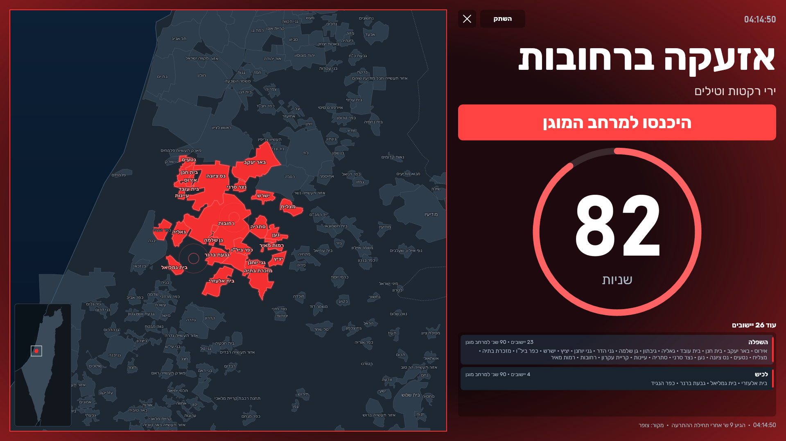
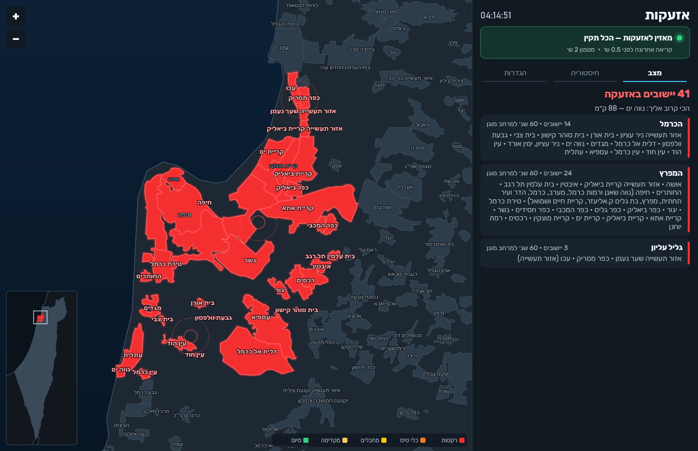
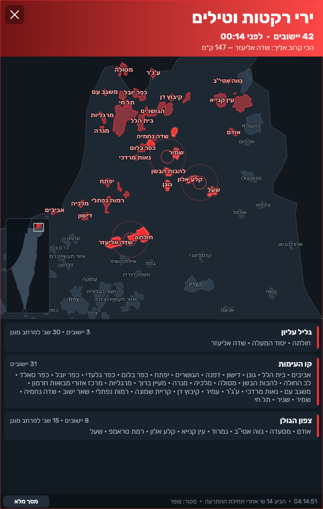

# SirenDesk · אזעקות

תוכנת Windows נייטיבית ב-Rust ו-Direct2D שמציגה על המסך את התרעות פיקוד העורף ברגע שהן מתפרסמות: מפה חיה של אזורי ההתרעה, מסך מלא עם ספירה לאחור כשיש אזעקה במקום שלכם, פאנל צד לאזעקות במקומות אחרים, התרעה מקדימה וסיום אירוע, ושכבה לשידור חי ב-OBS בעברית ובאנגלית.
קובץ אחד, בלי דפדפן, בלי Electron ובלי התקנה.

*A native Windows app (Rust + Direct2D) that shows Israel's Home Front Command alerts on screen the moment they are published: a live map of the alert areas, a full-screen takeover with a shelter countdown when your own place is under alert, a side panel for other places, early warnings and all-clears, and an OBS overlay for live streams in Hebrew and English. English summary at the bottom.*

> **זו לא אפליקציה רשמית.** האפליקציה הרשמית של פיקוד העורף בטלפון היא הערוץ הראשי. מחשב כבוי, ישן או בלי אינטרנט לא מתריע.

<p align="center"> </p>
<p align="center"></p>

## מה קורה כשיש התרעה

| מה קרה | מסך | צליל |
|---|---|---|
| אזעקה ב"מקומות שלי" | מסך מלא על כל המסכים, ספירה לאחור לפי זמן המיגון של היישוב | סירנה עד סוף הספירה ועוד 15 שניות |
| אזעקה עד 15 ק"מ מהמקום שלי | פאנל בצד, עם שם היישוב הקרוב והמרחק | צליל חזק |
| אזעקה רחוקה | פאנל בצד, נעלם 45 שניות אחרי היישוב החדש האחרון | צליל קצר; בלילה (23:00–07:00) בלי צליל |
| התרעה מקדימה אצלי | פאנל כתום עד הודעת סיום, או 12 דקות | שלושה צלילים עולים |
| האירוע הסתיים אצלי | ירוק | צליל סיום; הסירנה נעצרת |
| אין קשר למקור 30 שניות | פס אדום למעלה וסמל אפור במגש | צליל נמוך, פעם אחת |

- חלון ההתרעה לא לוקח פוקוס, ואפשר להמשיך להקליד.
- המפה, הקווים של כל 1,449 יישובי ההתרעה ושמותיהם בנויים בתוך התוכנה, והיא עובדת בלי שרת מפות.
- מקור שנופל או מחזיר תשובה ישנה מוצג כתקלה, ולעולם לא כ"אין אזעקות".
- התוכנה חוזרת לבד אחרי קריסה.
- יש תרגילים, מסומנים בפס צהוב, ושום דבר מהם לא יוצא מהמחשב.

## בנייה

דרוש Windows 10 או 11, [Rust](https://rustup.rs) עם ה-toolchain של MSVC, ו-Python 3.
Windows SDK לא חובה: בלעדיו התוכנה נבנית עם הסמל הרגיל של Windows.

```bash
python tools/fetch_lists.py
```

```bash
cargo build --release
```

הסקריפט מוריד את רשימות היישובים והקווים של צופר. אלה הקבצים שלהם, ולכן הם לא נמצאים במאגר.
התוצאה נמצאת ב-`target/release/SirenDesk.exe`. כדאי להעתיק אותה לתיקייה משלה: התוכנה שומרת את הקבצים שלה בתיקייה `data/` שליד ה-exe.

## שימוש

- בהפעלה הראשונה בוחרים את "המקומות שלי" בלשונית ההגדרות. בלי מקום שנבחר, מסך מלא לא יופיע.
- התוכנה נרשמת לעלייה עם Windows. אפשר לכבות את זה בהגדרות.
- הסמל במגש מראה את המצב: ירוק פירושו מאזין, כתום פירושו קשר לא יציב, אפור פירושו אין קשר, ואדום פירושו יש אזעקה.
- כפתור X מסתיר את החלון למגש. יציאה מלאה היא רק מתפריט המגש.
- אפשרויות שורת פקודה:
  - `--background`: התחלה במגש.
  - `--mute`: בלי צליל.
  - `--data-dir <dir>`: תיקיית נתונים אחרת.
  - `--snapshot <scene> out.png`: מצייר מצב לתמונה בלי חלון. הסצנות ב-`src/snapshot.rs`.

קבצים ב-`data/`:
- `settings.json`
- `status.json`: מצב חי, לכלים חיצוניים.
- `alerts.jsonl`: כל התרעה עם זמני ההגעה שלה.
- `log/`

## מקורות

- **ה-API הציבורי של צופר:** אזעקות, התרעות מקדימות, סיום אירוע ויומן.
- **קובצי הנתונים באתר של פיקוד העורף:** ההתרעות החיות וההיסטוריה.

הניסוחים הרשמיים של ההתרעות, ב-`assets/titles.json`, הם הבסיס לבדיקות שמוודאות שכל ניסוח רשמי נקרא נכון.

## שידור חי (OBS)

התוכנה מגישה את ההתרעות בכתובת `http://127.0.0.1:8150`, רק מהמחשב עצמו.
הדף `assets/broadcast.html` הוא שכבה שקופה בגודל 1920 על 1080:
- פס עליון.
- כרטיס מפה בצד המצלמה.
- מצבים: אזעקה, המשך שהייה, התרעה מקדימה, האירוע הסתיים.

איך מוסיפים אותו:
1. ב-OBS מוסיפים מקור דפדפן מקובץ מקומי, ומציבים אותו בראש הסצנה.
2. אפשרויות בכתובת הדף:
   - `?lang=he|en|both`: עברית, אנגלית, או שתיהן לסירוגין.
   - `?side=right`: הכרטיס בצד הימני של המצלמה.
   - `?sound=1`: צליל קצר בגל אזעקה חדש.
3. אוטומציה דרך obs-websocket: `node tools/obs_overlay.js status|add|show|hide|lang <he|en|both>`.

מה לא יוצא לשידור אף פעם: תרגיל, "המקומות שלי", מרחק מהבית. בדיקה ב-`src/broadcast.rs` מוודאת את זה.

## בדיקות

```bash
cargo test
```

```bash
python -I -X utf8 tools/e2e.py target/release/SirenDesk.exe <work dir>
```

`e2e.py` מריץ את כל הנתיב מול מקור מדומה מקומי (`tools/feed_standin.py`): מהירות, מטח גדול, מקור שנופל, קריסה. הוא שקט ומסומן כתרגיל על המסך.
`ui_test.py` לוחץ על הכפתורים האמיתיים.

## קרדיטים

- **מפת בסיס:** [Natural Earth](https://www.naturalearthdata.com), public domain (`assets/basemap.json`, נבנה ב-`tools/bake_basemap.py`).
- **רשימות היישובים והקווים:** [צופר](https://www.tzevaadom.co.il), לא כלולות, מורדות ב-`tools/fetch_lists.py`.
- **ספריות:** [windows-rs](https://github.com/microsoft/windows-rs), [serde](https://serde.rs).

## רישיון

[MIT](LICENSE).

---

## English summary

SirenDesk is a single native exe (Rust, Direct2D, DirectWrite, WinHTTP) for Windows 10/11:

- **Alerts on screen:** it polls Tzofar's public API and Home Front Command's website data files, and shows each alert as soon as it is read.
  - Full screen with a shelter countdown on every monitor when one of *your places* is under alert.
  - A side panel with a live map for other places.
  - Early warnings and all-clears.
- **Honest health:** a source that fails or serves stale answers is shown as a problem, never as "no alerts".
- **Broadcast overlay:** a transparent 1920x1080 OBS overlay in Hebrew, English, or both in turn.

**Build:** `python tools/fetch_lists.py`, then `cargo build --release`. The place lists are Tzofar's files and are not redistributed here.

**Not an official app:** keep the official Home Front Command app on your phone as your primary alert channel.

**License:** MIT.
